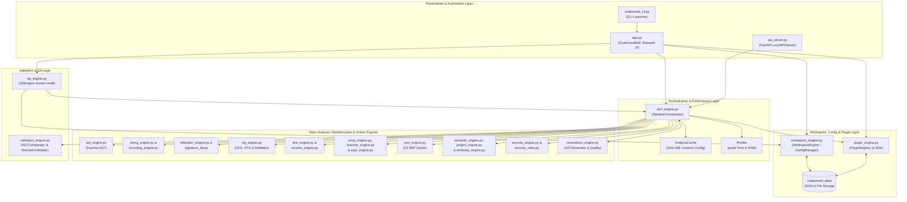
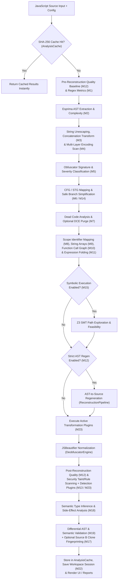

<div align="center">

# 🛡️ CodeUnveil

### Reveal the Logic Behind Obfuscated Code.

[](#roadmap-and-project-status)
[](#technology-stack)
[](LICENSE)
[](#quick-start-guide)
[](#core-features)
[](#testing-and-quality-assurance)
<!-- Replace <OWNER>/<REPO> below with your actual GitHub username and repository name -->
[](.github/workflows/ci.yml)

**CodeUnveil** is a static JavaScript deobfuscation and program analysis laboratory built in Python. It combines Abstract Syntax Tree (AST) manipulation, multi-layer encoding resolution, Control Flow Graph (CFG) reconstruction, Z3-backed symbolic execution, semantic type inference, and static taint tracking to transform heavily obfuscated JavaScript into readable, structured, and auditable source code—**without ever executing untrusted scripts.**

[Quick Start](#quick-start-guide) • [Core Features](#core-features) • [Architecture](#architecture-overview) • [Security Model](#security-model) • [Documentation](docs/)

</div>

---

## Table of Contents

- [Project Overview](#project-overview)
- [Core Features](#core-features)
- [Architecture Overview](#architecture-overview)
- [Analysis Pipeline](#analysis-pipeline)
- [Installation Guide](#installation-guide)
- [Quick Start Guide](#quick-start-guide)
- [Project Structure](#project-structure)
- [Technology Stack](#technology-stack)
- [Security Model](#security-model)
- [Testing and Quality Assurance](#testing-and-quality-assurance)
- [Supported JavaScript Syntax](#supported-javascript-syntax)
- [Screenshots and Visual Demonstration](#screenshots-and-visual-demonstration)
- [Example Workflow](#example-workflow)
- [Limitations](#limitations)
- [Roadmap and Project Status](#roadmap-and-project-status)
- [Contributing](#contributing)
- [License and Acknowledgements](#license-and-acknowledgements)

---

## Project Overview

Modern JavaScript obfuscators—whether used for commercial intellectual property protection or malicious payload evasion—employ layered transformations that degrade human comprehension and defeat naive regular-expression tools. Techniques such as **hexadecimal/Unicode string escaping**, **centralized string lookup arrays with index rotation**, **dead code injection**, **identifier mangling**, **wrapper function indirection**, and **state-machine control flow flattening** obscure the true intent of a program.

### What Problems CodeUnveil Addresses
Dynamic analysis (executing code in a sandbox or browser debugger) carries inherent operational risk when handling potentially weaponized scripts and often fails to trigger environment-gated branches. Conversely, basic code beautifiers only fix whitespace without addressing structural or semantic obfuscation.

**CodeUnveil** bridges this gap by operating as a **100% static, AST-driven analysis and reconstruction laboratory**:
1. **Structural Deobfuscation:** Parses raw source code into an Abstract Syntax Tree to fold constants, inline function wrappers, resolve string array lookups, and unroll deterministic state-machine dispatchers.
2. **Mathematical Branch Analysis:** Integrates the **Z3 Theorem Prover** (`z3-solver`) to evaluate path conditions symbolically and identify provably infeasible (dead) branches.
3. **Program & Security Understanding:** Infers variable types, maps read/write data dependencies, detects circular module imports across multi-file archives, and scans for static security indicators (such as DOM-XSS sinks and dynamic `eval` invocations).
4. **Verification & Auditability:** Validates transformations through AST differential analysis, semantic consistency checks, and persistent workspace session histories.

### Target Audience
* **Security Researchers & Malware Analysts:** Safely triage suspicious scripts, exploit kits, and obfuscated loaders without executing untrusted payloads.
* **Reverse Engineers:** Reconstruct readable control flow, rename mangled identifiers by scope, and inspect call/dependency graphs.
* **Application Security & SOC Teams:** Automate static inspection and structural clone fingerprinting across JavaScript codebases via the built-in REST API.
* **Compiler & Program Analysis Engineers:** Experiment with AST normalization, symbolic constraint generation, and custom Python analysis plugins.

---

## Core Features

CodeUnveil's capabilities are modularized across 20 specialized engineering domains, all backed by verified implementations in the repository.

### Feature Summary Matrix

| Domain | Module(s) | Key Capabilities |
| :--- | :--- | :--- |
| **A. Core Deobfuscation** | `perf_engine.py` | Regex metric baseline (hex literals, escaped strings, array accesses) and `jsbeautifier` source normalization. |
| **B. AST Analysis** | `ast_engine.py` | Full `esprima` AST generation, node counting, function/variable inventory, and cyclomatic complexity calculation. |
| **C. String & Encoding** | `string_engine.py`<br>`encoding_engine.py` | Hex/Unicode string unescaping, static string concatenation folding, and multi-layer Base64/Hex/URL/ROT13 payload decoding. |
| **D. Obfuscation Detection** | `detection_engine.py`<br>`signature_db.py` | Heuristic and AST signature matching, severity scoring (Levels 0–5), and obfuscator tool family fingerprinting. |
| **E. Control Flow Analysis** | `cfg_engine.py` | Basic block/branch/loop counting, Graphviz CFG generation, State Transition Graph (STG) extraction, and safe static deflattening. |
| **F. Dead Code Analysis** | `dce_engine.py` | Scope-aware tracking of unused variables/functions, unreachable post-return statements, and constant-branch pruning. |
| **G. Identifier Analysis** | `rename_engine.py` | Lexical scope resolution, obfuscated name detection (`_0x...`), context-aware semantic renaming suggestions, and range-based replacement. |
| **H. Function & Expression** | `function_engine.py`<br>`expr_engine.py` | Call graph generation, IIFE/arrow function tracking, constant/forwarding wrapper inlining, and JS-compliant constant folding. |
| **I. Source Reconstruction** | `reconstruct_engine.py` | Custom AST-to-JS code generator (`ASTGenerator`) and pre/post-pipeline readability metrics (nesting depth, statement density). |
| **J. Static Security Analysis** | `security_engine.py`<br>`security_rules.py` | Static taint/pattern scanning for `eval`, `Function`, DOM sinks, network calls, and analyst false-positive status management. |
| **K. Symbolic Analysis** | `sym_engine.py` | Bounded AST path exploration, symbolic variable tracking, path condition extraction, and Z3 `SAT`/`UNSAT` branch feasibility solving. |
| **L. Dependency Analysis** | `project_engine.py` | In-memory `.zip` project extraction, ES6/CommonJS import/export mapping, relative path resolution, and DFS circular cycle detection. |
| **M. Code Similarity** | `similarity_engine.py` | Type-1 (exact), Type-2 (identifier/literal normalized), and Type-3 (Jaccard/Cosine/CFG edge) structural clone fingerprinting. |
| **N. Semantic Analysis** | `semantic_engine.py` | Scoped symbol tables, read/write counters, union-aware static type inference, function purpose classification, and side-effect detection. |
| **O. Automated Validation** | `validation_engine.py` | Deep AST differential analysis (added/removed/modified nodes), semantic consistency validation, and metamorphic/parser fuzz tests. |
| **P. Performance Engine** | `perf_engine.py` | Centralized `PipelineOrchestrator`, SHA-256 content+config `AnalysisCache`, `psutil` RAM/time stage profiler, and `ProcessPoolExecutor` helpers. |
| **Q. Interactive IDE UI** | `app.py` | Multi-page Streamlit interface, `streamlit-ace` syntax editors, Graphviz visualizers, toast notifications, and `>` global command routing. |
| **R. Workspace Management** | `workspace_engine.py` | Persistent `.codeunveil_data` JSON database for Workspaces, Projects, Config Profiles (`Project > Workspace > Profile`), and Sessions. |
| **S. Plugin & API System** | `plugin_engine.py`<br>`api_server.py` | Explicit-trust Python Plugin SDK (`DetectionPlugin`, `TransformationPlugin`, `AnalysisPlugin`) and background FastAPI server (`/api/v1/analyze`). |
| **T. Reporting & QA** | `qa_engine.py`<br>`security_engine.py` | Self-diagnosing system audit harness and downloadable JSON, CSV, HTML, and `.zip` project exports. |

<details>
<summary><strong>🔍 Expand Detailed Breakdown of All 20 Feature Categories (A–T)</strong></summary>

#### A. Core Deobfuscation (`CodeAnalyzer`, `DeobfuscatorEngine`)
* **Purpose:** Establishes baseline syntactic metrics and normalizes formatting.
* **Verified Capabilities:** Counts hexadecimal literals (`0x...`), escaped characters (`\x..`, `\u....`), long encoded strings, and numeric array accesses; reformats compressed/minified code with configurable indentation and chained-method breaking via `jsbeautifier`.
* **Practical Usefulness:** Turns single-line minified scripts into readable multi-line structures prior to deep inspection.

#### B. AST Analysis (`ASTAnalyzer`)
* **Purpose:** Parses raw JavaScript into a structured Abstract Syntax Tree for deterministic inspection.
* **Verified Capabilities:** Uses `esprima.parseScript` (with tolerant mode and range/location tracking) to compute total AST nodes, function declarations, variable/constant counts, and cyclomatic complexity.
* **Practical Usefulness:** Provides an interactive JSON tree in the UI and supplies structural metadata to downstream engines.

#### C. String and Encoding Analysis (`StringAnalyzer`, `EncodingAnalyzer`)
* **Purpose:** Extracts, unescapes, and decodes obfuscated string literals and multi-layer payloads.
* **Verified Capabilities:** Decodes hex/Unicode escapes inside string literals, folds static binary string concatenations (`"a" + "b" -> "ab"`), and recursively peels up to multiple layers of Base64, Hex, URL, and ROT13 encodings (including an interactive manual decoder sandbox).
* **Practical Usefulness:** Reveals hidden URLs, command strings, and stage-2 payloads without running the script.

#### D. Obfuscation Detection (`DetectionEngine`, `signature_db.py`)
* **Purpose:** Classifies the severity and likely tooling behind an obfuscated script.
* **Verified Capabilities:** Evaluates AST and regex signatures to assign a Severity Level (`0` to `5`), identifies specific obfuscation techniques, and fingerprints tool families (such as Obfuscator.io patterns) with supporting evidence.
* **Practical Usefulness:** Gives analysts immediate triage context on how heavily a sample is armored.

#### E. Control Flow Analysis & Deflattening (`CFGAnalyzer`)
* **Purpose:** Maps execution topology and reconstructs flattened control flow structures.
* **Verified Capabilities:** Identifies basic blocks, conditional branches, loops, and `switch` statements; detects `while`+`switch` state-machine dispatchers (both array-split `'1|3|2'.split('|')` and numeric state-variable transitions); generates Graphviz DOT diagrams for CFGs and State Transition Graphs (STG); safely unrolls deterministic linear dispatchers and prunes literal truthy/falsy `if` branches.
* **Practical Usefulness:** Defeats switch-based control flow flattening and visualizes execution paths.

#### F. Dead Code Analysis (`DCEAnalyzer`)
* **Purpose:** Identifies and optionally removes redundant or unreachable code constructs.
* **Verified Capabilities:** Tracks variable and function declarations against lexical references to flag unused identifiers, detects unreachable statements following `return`/`throw`/`break`/`continue`, and isolates safely removable AST ranges.
* **Practical Usefulness:** Strips junk code injected by obfuscators to inflate file size and confuse analysts.

#### G. Identifier Analysis (`RenameAnalyzer`)
* **Purpose:** Resolves lexical scopes and replaces unreadable variable names with meaningful identifiers.
* **Verified Capabilities:** Maps declarations and reference ranges across global, function, and block scopes; flags suspicious/mangled names (e.g., hex-style `_0x...` or single-character collisions); proposes context-aware renames in an interactive table; applies replacements bottom-up by AST character range.
* **Practical Usefulness:** Restores human readability to variable and function names without breaking lexical bindings.

#### H. Function and Expression Analysis (`FunctionAnalyzer`, `ExprAnalyzer`)
* **Purpose:** Simplifies wrapper functions and folds mathematical/logical expressions.
* **Verified Capabilities:** Classifies functions (IIFEs, arrow functions, constant-return wrappers, binary/call-forwarding proxies), builds a Graphviz Function Call Graph, inlines approved wrapper calls, and folds static binary/unary/logical expressions (`2 + 3 -> 5`, `true && x -> x`) using JavaScript-aware semantics.
* **Practical Usefulness:** Eliminates proxy function indirection and obfuscator math puzzles.

#### I. Source Reconstruction (`ASTGenerator`, `CodeQualityAnalyzer`, `ReconstructionPipeline`)
* **Purpose:** Regenerates clean JavaScript directly from AST nodes and measures readability improvements.
* **Verified Capabilities:** Recursively serializes supported AST nodes back into clean JavaScript source code and calculates before/after readability metrics (total lines, average line length, maximum nesting depth, and statement density).
* **Practical Usefulness:** Provides quantifiable proof of structural simplification alongside side-by-side code comparison.

#### J. Static Security Analysis (`SecurityAnalyzer`, `security_rules.py`)
* **Purpose:** Detects suspicious API usage, dangerous sinks, and malware indicators statically.
* **Verified Capabilities:** Scans AST nodes against extensible security rules (`Critical`, `High`, `Medium`, `Low`, `Informational`), tracks findings by line number and snippet, and provides an interactive review table where analysts can mark items as `Open`, `Reviewed`, or `False Positive` with custom notes.
* **Practical Usefulness:** Highlights high-risk behaviors (such as `eval()`, DOM manipulation, or network exfiltration calls) immediately after deobfuscation.

#### K. Symbolic Analysis (`SymEngine`, `SymState`, `SymPath`)
* **Purpose:** Mathematically evaluates branch feasibility using SMT constraint solving.
* **Verified Capabilities:** Symbolically executes AST statements up to configurable depth (`max_depth`) and loop unrolling limits (`max_loop_iter`), translates JS conditions into Z3 expressions, and invokes `z3.Solver()` with timeouts to classify branches as `Feasible` (`SAT`), `Infeasible` (`UNSAT`), or `Unknown`.
* **Practical Usefulness:** Proves whether complex conditional branches (opaque predicates) can ever be taken at runtime.

#### L. Dependency Analysis (`ProjectAnalyzer`)
* **Purpose:** Analyzes multi-file JavaScript projects and module relationships safely in memory.
* **Verified Capabilities:** Extracts `.zip` archives purely in memory (`io.BytesIO`) with path traversal neutralization, parses `package.json`, extracts ES6 (`import`/`export`) and CommonJS (`require`/`module.exports`) declarations, resolves relative module paths (`.js`, `.mjs`, `/index.js`), detects circular dependency chains via Depth-First Search (DFS), counts isolated modules, and renders a project Dependency Graph.
* **Practical Usefulness:** Scales CodeUnveil from single scripts to full multi-module packages and bundlers.

#### M. Code Similarity Analysis (`SimilarityEngine`, `ASTNormalizer`)
* **Purpose:** Performs clone detection and structural fingerprinting across two JavaScript sources.
* **Verified Capabilities:** Extracts exact AST token sequences (Type-1 clones) and identifier/literal-normalized sequences (`VAR`/`LIT` normalization for Type-2 clones), computes SHA-256 structural fingerprints, and calculates a composite similarity score combining AST Jaccard similarity (40%), Cosine token frequency similarity (40%), and CFG branch similarity (20%).
* **Practical Usefulness:** Determines whether two differently obfuscated scripts share the same underlying codebase or malware family.

#### N. Semantic Analysis (`SemanticAnalyzer`, `SemanticScope`, `SemanticSymbol`)
* **Purpose:** Builds a program understanding model covering symbol tables, types, and side effects.
* **Verified Capabilities:** Tracks symbol declarations, scope depth, read/write counts, and identifier-to-identifier data dependencies; performs conservative static type inference (supporting union types such as `{"String", "Number"}`); classifies function intent (`Network Interaction`, `DOM Manipulation`, `Mathematical Operation`, `Validation Logic`, `Utility Function`); flags global/DOM/network side effects; renders a Graphviz Data Dependency Graph.
* **Practical Usefulness:** Summarizes what functions and variables actually do without manual line-by-line tracing.

#### O. Automated Validation (`ValidationEngine`, `ASTComparator`, `SemanticValidator`)
* **Purpose:** Audits transformations to detect unexpected structural or semantic regressions.
* **Verified Capabilities:** Performs recursive AST differential analysis (counting `preserved`, `modified`, `added`, and `removed` nodes and flagging dangerous shifts like `CallExpression -> AssignmentExpression`), compares pre/post-transformation symbol tables and side effects, and runs built-in metamorphic idempotency and parser fuzz tests.
* **Practical Usefulness:** Ensures deobfuscation passes do not silently corrupt program semantics or introduce new side effects.

#### P. Performance Optimization (`PipelineOrchestrator`, `AnalysisCache`, `Profiler`, `ParallelProcessor`)
* **Purpose:** Orchestrates all analysis stages with caching, profiling, and parallel task helpers.
* **Verified Capabilities:** Fingerprints source code + active configuration via SHA-256 (`AnalysisCache`) to return instant `O(1)` results on repeated runs, profiles execution time (`ms`) and memory deltas (`MB`) per stage using `psutil`, and provides `ProcessPoolExecutor` task mapping.
* **Practical Usefulness:** Eliminates redundant computation and highlights stage bottlenecks in the UI.

#### Q. Interactive Visualization & IDE Experience (`CodeUnveilIDE` in `app.py`)
* **Purpose:** Delivers a cohesive, dark-themed developer environment in Streamlit.
* **Verified Capabilities:** Features sidebar navigation across 12 dedicated views, `streamlit-ace` syntax-highlighted editors with selectable themes (`monokai`, `github`, `tomorrow_night`, `dracula`, `eclipse`), a `>` Global Command bar (e.g., `> ast`, `> security`, `> qa`), Graphviz chart rendering, and timestamped toast notifications.
* **Practical Usefulness:** Centralizes editing, transformation previews, graph exploration, and reporting in a single workspace.

#### R. Project and Workspace Management (`WorkspaceEngine`, `ConfigManager`, `HistoryManager`, `WorkspaceDB`)
* **Purpose:** Persists workspaces, multi-file projects, hierarchical configurations, and session snapshots locally.
* **Verified Capabilities:** Stores JSON tables in `.codeunveil_data/`, resolves configuration inheritance (`Project > Workspace > Profile` across `Balanced`, `Deep Security Analysis`, and `Fast Analysis` profiles), logs project audit history events, saves/reloads analysis sessions, and exports/imports project `.zip` archives safely.
* **Practical Usefulness:** Allows analysts to organize ongoing investigations, switch projects, and resume past sessions.

#### S. Plugin Architecture & Programmatic API (`PluginRegistry`, `LocalAPIServer`)
* **Purpose:** Extends CodeUnveil with custom Python plugins and headless HTTP automation.
* **Verified Capabilities:** Provides base SDK classes (`BasePlugin`, `DetectionPlugin`, `TransformationPlugin`, `AnalysisPlugin`) with explicit permission declarations (`read_ast`, `read_semantics`, `write_transform`, `register_rules`) and a mandatory user approval gate before activation; includes a background `FastAPI`/`uvicorn` server (`127.0.0.1:8000`) exposing `POST /api/v1/analyze` and `GET /api/v1/health`.
* **Practical Usefulness:** Enables teams to plug in proprietary detection rules or integrate CodeUnveil into automated CI/SOAR pipelines.

#### T. Reporting, Export & Quality Assurance (`QAEngine`)
* **Purpose:** Generates portable analysis artifacts and verifies runtime health.
* **Verified Capabilities:** Exports reconstructed `.js` files, JSON reports (AST, encoding, CFG, DCE, identifiers, arrays, functions, expressions, quality, security, symbolic, project architecture, similarity, semantics, validation, QA), CSV/HTML security reports, HTML QA reports, and `.zip` project archives; runs live self-diagnostics across storage, parser robustness, security bounds, and cross-module integration.
* **Practical Usefulness:** Produces audit-ready documentation and verifies environment integrity on demand.

</details>

---

## Architecture Overview

CodeUnveil follows a layered, modular architecture where presentation, orchestration, static analysis engines, persistence, and extensibility are cleanly decoupled.

* **Presentation & API Layer (`app.py`, `codeunveil_cli.py`, `api_server.py`):** Provides the interactive `CodeUnveilIDE` Streamlit interface, the `codeunveil` CLI launcher, and the optional background `FastAPI` REST server (`LocalAPIServer`).
* **Orchestration & Performance Layer (`perf_engine.py`):** `PipelineOrchestrator` coordinates the execution sequence of all engines, wrapping each step in the `psutil`-backed `Profiler` and checking the SHA-256 `AnalysisCache` to bypass redundant runs.
* **Parsing & Core AST Layer (`ast_engine.py`, `esprima`):** Converts raw JavaScript into location-annotated AST structures shared across downstream analyzers.
* **Static Analysis & Solver Layer:** Houses specialized read-only analyzers for strings (`string_engine.py`), encodings (`encoding_engine.py`), obfuscator signatures (`detection_engine.py`), control flow (`cfg_engine.py`), dead code (`dce_engine.py`), identifiers (`rename_engine.py`), arrays (`array_engine.py`), functions (`function_engine.py`), expressions (`expr_engine.py`), security taint/rules (`security_engine.py`), Z3 symbolic execution (`sym_engine.py`), multi-file projects (`project_engine.py`), clone similarity (`similarity_engine.py`), and semantics (`semantic_engine.py`).
* **Transformation & Reconstruction Layer (`reconstruct_engine.py`, `jsbeautifier`):** Applies range-based source replacements, AST-to-source regeneration (`ASTGenerator`), and final code formatting (`DeobfuscatorEngine`).
* **Validation & QA Layer (`validation_engine.py`, `qa_engine.py`):** Performs AST diffing (`ASTComparator`), semantic consistency checks (`SemanticValidator`), metamorphic tests, and full-system health audits (`QAEngine`).
* **Workspace, Plugin & Storage Layer (`workspace_engine.py`, `plugin_engine.py`):** Manages persistent local state in `.codeunveil_data/`, hierarchical configuration resolution (`ConfigManager`), and explicit-trust plugin lifecycle hooks (`PluginRegistry`).



---

## Analysis Pipeline

When an analyst triggers a run from the **💻 Code Editor** or via `POST /api/v1/analyze`, `PipelineOrchestrator.execute()` runs a deterministic, stage-profiled workflow:



---

## Installation Guide

### Prerequisites
* **Python:** `3.11`, `3.12`, or `3.13` (configured in `pyproject.toml` as `>=3.11`).
* **pip & venv:** Standard Python package and virtual environment tools.
* **Graphviz (Optional System Binary):** Streamlit's `st.graphviz_chart` renders DOT graphs in the browser; having Graphviz installed on your system path is recommended for complex graph layouts.

### Step 1: Clone the Repository
```bash
# Replace <OWNER>/<REPO> with your actual GitHub repository path
git clone [https://github.com/](https://github.com/)<OWNER>/<REPO>.git
cd CodeUnveil
```

### Step 2: Create and Activate a Virtual Environment

**Linux / macOS:**
```bash
python3 -m venv .venv
source .venv/bin/activate
```

**Windows (Command Prompt):**
```cmd
python -m venv .venv
.venv\Scripts\activate
```

**Windows (PowerShell):**
```powershell
python -m venv .venv
.venv\Scripts\Activate.ps1
```

### Step 3: Install Dependencies
You can install CodeUnveil either via the locked `requirements.txt` or as an editable PEP 517 package using `pyproject.toml` (which registers the `codeunveil` CLI command):

```bash
# Option A: Install as an editable package with CLI entrypoint and dev tools (Recommended)
python -m pip install --upgrade pip
pip install -e .[dev]

# Option B: Install pinned dependencies directly from requirements.txt
pip install -r requirements.txt
```

### Step 4: Launch the Application
```bash
# If installed via pip install -e .
codeunveil

# Or launch directly via Streamlit
streamlit run app.py
```
The application will open in your default browser at `http://localhost:8501`.

<details>
<summary><strong>🛠️ Troubleshooting Common Installation Issues</strong></summary>

* **`codeunveil: command not found`:** Ensure your virtual environment is activated and that you ran `pip install -e .` so `setuptools` registers the script entry point defined in `pyproject.toml`. Alternatively, run `python codeunveil_cli.py` or `streamlit run app.py`.
* **`z3-solver` installation slow or failing on unsupported architectures:** Ensure `pip` is upgraded (`python -m pip install --upgrade pip`) so it fetches the precompiled manylinux/macOS/Windows wheel for `z3-solver`.
* **Port `8501` or `8000` already in use:** Specify an alternate port for Streamlit via `streamlit run app.py --server.port 8502`. The optional FastAPI server binds to port `8000` only when manually started from the **🧩 Plugins & API** tab.

</details>

---

## Quick Start Guide

1. **Install and Launch:** Activate your virtual environment and run `codeunveil` (or `streamlit run app.py`).
2. **Create or Select a Project (Optional):** Navigate to **📁 Workspace & Projects** in the sidebar. Create a new project under the `Default Workspace`, or upload `.js` files to associate with your project.
3. **Configure Analysis Profile (Optional):** Open **⚙️ Config & Profiles** to inspect the active profile (`Balanced Analysis`, `Deep Security Analysis`, or `Fast Analysis`).
4. **Open the Deobfuscation Editor:** Navigate to **💻 Code Editor** (or type `> editor` in the sidebar **🔍 Global Command** box).
5. **Provide JavaScript Source Code:** Paste obfuscated JavaScript directly into the **Original Source** Ace editor panel, or load a file from your active project in **📁 Workspace & Projects**.
6. **Execute Static Analysis:** Click **🚀 Execute v1.0.0 Orchestrated Pipeline**.
7. **Inspect Reconstructed Code & Transformations:**
   * View the formatted and reconstructed code immediately in the **Transformed Source (Output)** editor panel.
   * Navigate to **🛠️ Transform Studio** to inspect decoded strings, multi-layer encodings, removable dead code ranges, identifier rename suggestions, string array lookups, wrapper inlinings, and folded expressions.
8. **Explore Graphs, Semantics & Security:**
   * Open **🌳 AST & Semantics** to browse the interactive AST JSON, scoped symbol tables, inferred types, and function classifications.
   * Open **🔀 Graph Explorer** to view the Control Flow Graph (CFG), State Transition Graph (STG), Data Dependency Graph, and Function Call Graph.
   * Open **🛡️ Security Center** to review static security findings and obfuscator fingerprints.
   * Open **⚡ Validation & Perf** to inspect stage execution timings, memory usage, AST differential counts, and Z3 branch feasibility results.
9. **Export Artifacts:** Click **💾 Download Output** in the Code Editor to save the reconstructed `.js` file, export your project as a `.zip` in **📁 Workspace & Projects**, or run and export a full system audit report (JSON/HTML) in **✅ Quality Assurance**.

---

## Project Structure

```text
CodeUnveil/
├── .github/
│   └── workflows/
│       └── ci.yml                      # GitHub Actions CI matrix (Python 3.11, 3.12, 3.13)
├── docs/
│   ├── README.md                       # Package documentation copy
│   ├── SECURITY.md                     # Threat model and static analysis boundaries
│   ├── SUPPORTED_SYNTAX.md             # Esprima JS syntax compatibility documentation
│   ├── CHANGELOG.md                    # Release history (Milestones 1–25 / v1.0.0)
│   ├── DRAFT_RELEASE_NOTES.md          # v1.0.0 release summary
│   └── FINAL_VALIDATION_REPORT.md      # Milestone 25 validation checklist
├── plugins/                            # Local directory scanned by PluginRegistry
│   └── templates/                      # Reference plugin templates
├── tests/                              # Automated Pytest regression & integration suite
│   ├── __init__.py
│   ├── test_cfg_engine.py              # CFG, STG, and CFF deflattening tests
│   ├── test_sym_engine.py              # Z3 symbolic execution & feasibility tests
│   ├── test_project_engine.py          # In-memory ZIP, imports/exports & cycle tests
│   ├── test_similarity_engine.py       # Type-1/2/3 clone & fingerprint tests
│   ├── test_semantic_engine.py         # Type inference, symbol table & side-effect tests
│   ├── test_validation_engine.py       # AST diffing, semantic contracts & fuzzer tests
│   ├── test_perf_engine.py             # SHA-256 caching & PipelineOrchestrator tests
│   ├── test_ui.py                      # Streamlit state & global command router tests
│   ├── test_workspace_engine.py        # WorkspaceDB, config inheritance & export tests
│   ├── test_plugin_engine.py           # Plugin lifecycle, trust gates & LocalAPIServer tests
│   ├── test_integration.py             # End-to-end M1–M23 cross-module pipeline tests
│   └── test_qa_engine.py               # Self-diagnosing QAEngine audit & HTML report tests
├── app.py                              # Main Streamlit IDE application (CodeUnveilIDE)
├── codeunveil_cli.py                   # CLI entrypoint (`codeunveil`)
├── api_server.py                       # Optional headless FastAPI server (LocalAPIServer)
├── perf_engine.py                      # PipelineOrchestrator, AnalysisCache & Profiler
├── workspace_engine.py                 # WorkspaceEngine, ConfigManager, HistoryManager & DB
├── plugin_engine.py                    # PluginRegistry, permissions & developer SDK classes
├── qa_engine.py                        # QAEngine internal diagnostics & report generator
├── validation_engine.py                # ASTComparator, SemanticValidator & contracts
├── semantic_engine.py                  # SemanticAnalyzer, type inference & symbol tables
├── similarity_engine.py                # SimilarityEngine & ASTNormalizer clone detector
├── project_engine.py                   # ProjectAnalyzer multi-file ZIP & dependency mapper
├── sym_engine.py                       # SymEngine Z3 constraint solver integration
├── security_engine.py                  # SecurityAnalyzer static taint & rule scanner
├── security_rules.py                   # Static AST security detection rules
├── reconstruct_engine.py               # ASTGenerator & CodeQualityAnalyzer
├── expr_engine.py                      # ExprAnalyzer constant folding & propagation
├── function_engine.py                  # FunctionAnalyzer call graphs & wrapper inlining
├── array_engine.py                     # ArrayAnalyzer string table & rotation tracking
├── rename_engine.py                    # RenameAnalyzer lexical scope & identifier renaming
├── dce_engine.py                       # DCEAnalyzer dead code & unused symbol detection
├── cfg_engine.py                       # CFGAnalyzer control flow & CFF deflattening
├── detection_engine.py                 # DetectionEngine obfuscator classification
├── signature_db.py                     # Obfuscation signature definitions
├── encoding_engine.py                  # EncodingAnalyzer multi-layer payload decoder
├── string_engine.py                    # StringAnalyzer literal unescaping & folding
├── ast_engine.py                       # ASTAnalyzer Esprima parser wrapper & metrics
├── pyproject.toml                      # PEP 517 build, Ruff, Pytest & MyPy configuration
├── requirements.txt                    # Locked production & development dependencies
└── LICENSE                             # MIT License
```

---

## Technology Stack

CodeUnveil relies on a focused, auditable set of Python libraries defined in `pyproject.toml` and `requirements.txt`:

| Category | Technology | Locked Version | Role in CodeUnveil |
| :--- | :--- | :--- | :--- |
| **Core Language** | Python | `>=3.11` | Primary implementation language for all analysis engines and orchestration. |
| **Web IDE Framework** | `streamlit` | `1.28.2` | Renders the multi-page interactive web interface, data tables, and Graphviz charts. |
| **Code Editor** | `streamlit-ace` | `0.1.1` | Embeds the Ace code editor with JS/Python syntax highlighting and keybindings. |
| **JS AST Parser** | `esprima` | `4.0.1` | Parses JavaScript source code into standard ESTree-compatible Abstract Syntax Trees. |
| **JS Formatter** | `jsbeautifier` | `1.14.11` | Normalizes whitespace, indentation, and method chains in reconstructed code. |
| **SMT Solver** | `z3-solver` | `4.12.2.0` | Powers symbolic execution path condition solving (`SAT`/`UNSAT` branch feasibility). |
| **Data & Tables** | `pandas` | `2.1.3` | Structures tabular analytics, symbol tables, profiler metrics, and CSV exports. |
| **System Profiling** | `psutil` | `5.9.6` | Measures per-stage RSS memory consumption (`MB`) and process metrics in `Profiler`. |
| **Programmatic API** | `fastapi` & `uvicorn` | `0.104.1` / `0.24.0.post1` | Serves the optional local REST API (`/api/v1/analyze` and `/api/v1/health`). |
| **Testing & Coverage** | `pytest` & `pytest-cov` | `7.4.3` / `4.1.0` | Runs unit, metamorphic, integration, UI, and coverage test suites. |
| **Code Quality & Security** | `ruff`, `mypy`, `bandit` | `0.1.6` / `1.7.0` / `1.7.5` | Enforces PEP 8 linting, static type checking, and Python security auditing in CI. |

---

## Security Model

CodeUnveil is engineered specifically to inspect **untrusted, potentially hostile JavaScript** (such as malware droppers, phishing kits, and obfuscated browser exploits). Its security architecture enforces strict static isolation:

### 1. Zero JavaScript Execution Guarantee
* **No Runtime Evaluation:** CodeUnveil **never** executes uploaded or analyzed JavaScript.
* **No `eval()` / `exec()` on Target Code:** All expression simplification (`expr_engine.py`), string decoding (`string_engine.py`), and state-machine deflattening (`cfg_engine.py`) are performed purely in Python over AST nodes.
* **No External JS Runtimes:** CodeUnveil never invokes Node.js, V8, browser engines, `npm`, or `npx` on analyzed files.
* **No Dependency Installation:** When analyzing multi-file projects (`project_engine.py`), `package.json` is parsed strictly as static JSON data; project dependencies are never fetched or installed.

### 2. Archive & File Upload Hardening
* **In-Memory ZIP Processing:** Project archives uploaded to `ProjectAnalyzer` are read directly in memory via `zipfile.ZipFile(io.BytesIO(zip_bytes))`.
* **Path Traversal Neutralization:** File paths containing `..` are rejected, leading slashes are stripped, and workspace file writes sanitize filenames through `os.path.basename()`.
* **Resource & Size Bounds:** Engines enforce strict safety limits, including a 2 MB source limit for CFG analysis (`cfg_engine.py`), a 5 MB per-file / 1,000-file cap for in-memory ZIP analysis (`project_engine.py`), a 10 MB per-file / 50 MB archive limit for workspace imports (`workspace_engine.py`), and bounded recursion/loop unrolling (`max_depth`, `max_loop_iter`) with solver timeouts (`500 ms`) in `sym_engine.py`.

### 3. Plugin Trust & Local API Boundaries
* **Explicit Plugin Approval:** Discovered Python plugins in `plugins/` are **never** loaded or executed automatically. A plugin remains inert until the user explicitly clicks **Approve Trust & Enable** in the UI (`plugin_engine.py`).
* **In-Process Plugin Notice:** Python plugins execute within the host Python process and are **not** OS-sandboxed. Only enable plugins from trusted authors.
* **Local-Only API Binding:** The optional FastAPI server (`api_server.py`) is stopped by default and binds strictly to `127.0.0.1` (localhost) when started.

> For full details on threat boundaries and reporting procedures, see [`docs/SECURITY.md`](docs/SECURITY.md).

---

## Testing and Quality Assurance

CodeUnveil includes a comprehensive automated test suite and a GitHub Actions CI/CD workflow (`.github/workflows/ci.yml`) configured to run across **Python 3.11, 3.12, and 3.13** on `ubuntu-latest`.

### Running Automated Tests
Execute the full test suite and generate a coverage report using `pytest`:
```bash
pytest tests/ --cov=. --cov-report=xml
```

### Running Linting, Type Checking & Security Audits
Run the exact static quality checks enforced by the CI pipeline:
```bash
# 1. Fast Python Linting (Ruff)
ruff check .

# 2. Static Type Checking (MyPy)
mypy . --ignore-missing-imports

# 3. Python Security Static Analysis (Bandit)
bandit -r . -x tests/,plugins/ -ll
```

### Building and Verifying the Package
Verify that both the source distribution (`sdist`) and wheel (`whl`) build cleanly:
```bash
python -m pip install --upgrade build
python -m build
```

### In-App Self-Diagnostics (`QAEngine`)
You can also run live runtime diagnostics directly inside the application by navigating to **✅ Quality Assurance** in the sidebar and clicking **🚀 Run Comprehensive v1.0.0 Audit**, which tests WorkspaceDB serialization, Esprima parser error handling, path traversal neutralization, plugin trust blocks, and end-to-end M1–M23 pipeline integration.

---

## Supported JavaScript Syntax

CodeUnveil uses `esprima` (`4.0.1`) for AST generation alongside custom AST walkers and generators. The table below reflects actual parser and engine support (see [`docs/SUPPORTED_SYNTAX.md`](docs/SUPPORTED_SYNTAX.md)):

| Syntax Feature / Standard | Status | Implementation Notes |
| :--- | :---: | :--- |
| **ES5 Core Syntax** (`var`, functions, objects, arrays, loops) | **Supported** | Full AST analysis, CFG mapping, constant folding, and source reconstruction. |
| **ES6 / ES2015** (`let`, `const`, lexical block scopes) | **Supported** | Tracked with block/function scope resolution in `dce_engine.py`, `rename_engine.py`, and `semantic_engine.py`. |
| **Arrow Functions** (`() => {}`) | **Supported** | Tracked in `ast_engine.py`, `function_engine.py` (including wrapper inlining), and `reconstruct_engine.py`. |
| **Classes** (`class`, `constructor`, methods) | **Supported** | Parsed by `esprima` in script/module modes and traversed across AST engines. |
| **Destructuring & Spread Syntax** | **Supported** | Parsed into AST nodes; complex destructuring assignments are handled conservatively by rename/symbolic passes. |
| **Template Literals** (`` `hello ${x}` ``) | **Supported** | Parsed by `esprima`; static string folding primarily targets standard `Literal` nodes. |
| **Async / Await & Generators** (`async`, `await`, `function*`) | **Partially Supported** | Parsed in tolerant AST mode; `sym_engine.py` conservatively treats asynchronous boundaries as `Unknown` constraints. |
| **ES Modules** (`import`, `export`, re-exports) | **Supported** | Analyzed via `esprima.parseModule` in `project_engine.py` for dependency graph construction. |
| **CommonJS Modules** (`require`, `module.exports`, `exports`) | **Supported** | Detected via AST `CallExpression` and `AssignmentExpression` patterns in `project_engine.py`. |
| **Regular Expressions** (`/pattern/flags`) | **Supported** | Parsed as `RegExp` literals and inferred as `{"RegExp"}` in `semantic_engine.py`. |
| **Optional Chaining (`?.`) & Nullish Coalescing (`??`)** | **Partially Supported** | Modern ES2020+ tokens may exceed `esprima` 4.0.1 grammar depending on context; handled via tolerant fallback or graceful error reporting. |
| **BigInt (`100n`) & Private Class Fields (`#priv`)** | **Partially Supported** | Subject to `esprima` 4.0.1 parser grammar limits; unsupported tokens fail safely without crashing the application. |
| **Dynamic Imports** (`import('...')`) | **Partially Supported** | Tracked in `project_engine.py` when the AST represents them as `Import` call expressions with literal arguments. |
| **TypeScript Type Annotations & Uncompiled JSX** | **Not Supported** | TypeScript annotations must be transpiled to standard JavaScript prior to analysis. |

---

## Screenshots and Visual Demonstration

> **Note:** Repository screenshots are not yet committed to the codebase. To add visual demonstrations, capture screenshots of the running Streamlit interface, save them under `docs/assets/`, and uncomment or update the image references below.

| Interface View | Suggested Asset Path | Description |
| :--- | :--- | :--- |
| **Executive Dashboard** | `docs/assets/dashboard.png` | High-level AST node counts, security risk summary, clone similarity score, and pipeline latency profiler. |
| **Code Editor & Pipeline** | `docs/assets/code_editor.png` | Side-by-side `streamlit-ace` editors showing obfuscated input vs. reconstructed output. |
| **Graph Explorer (CFG & STG)** | `docs/assets/graph_explorer.png` | Interactive Graphviz visualizations for Control Flow Graphs, State Transition Graphs, and Call Graphs. |
| **Transformation Studio** | `docs/assets/transform_studio.png` | Tabular inspection of decoded strings, multi-layer encodings, dead code ranges, and expression folds. |
| **Security & QA Centers** | `docs/assets/security_qa.png` | Static vulnerability findings table and the Milestone 24 self-diagnosing QA audit report. |

---

## Example Workflow

The following **illustrative example** demonstrates how CodeUnveil's static analysis stages process a harmless obfuscated JavaScript snippet containing hex-escaped strings, constant math expressions, dead branches, and a flattened `while`/`switch` state machine.

### 1. Original Obfuscated Input
```javascript
var _0xstate = '1|3|2'.split('|');
var _0xidx = 0;
var _0xunused = 42;

if (false) {
    console.log("Unreachable dead branch");
}

while (true) {
    switch (_0xstate[_0xidx++]) {
        case '1':
            var greeting = "\x48\x65\x6c\x6c\x6f" + " " + "\x57\x6f\x72\x6c\x64";
            continue;
        case '2':
            console.log(greeting, total);
            continue;
        case '3':
            var total = (10 * 5) + (20 - 8);
            continue;
    }
    break;
}
```

### 2. Reconstructed & Simplified Output
```javascript
var _0xstate = '1|3|2'.split('|');
var _0xidx = 0;

var greeting = "Hello World";
var total = 62;
console.log(greeting, total);
```

### 3. How CodeUnveil Processes This Sample
1. **String Unescaping & Concatenation Folding (`string_engine.py`):** Resolves `"\x48\x65\x6c\x6c\x6f"` to `"Hello"` and `"\x57\x6f\x72\x6c\x64"` to `"World"`, then folds the static binary concatenation into `"Hello World"`.
2. **Expression Constant Folding (`expr_engine.py`):** Evaluates `(10 * 5) + (20 - 8)` statically into `62`.
3. **Dead Branch & Unused Variable Elimination (`cfg_engine.py`, `dce_engine.py`):** Prunes the literal falsy `if (false) { ... }` block and removes the unreferenced `var _0xunused = 42;` declaration when Dead Code Removal (M7) is enabled.
4. **Control Flow Deflattening (`cfg_engine.py`):** Detects the `_0xstate` array-split dispatcher (`'1|3|2'`), maps cases `'1'`, `'2'`, and `'3'` into a State Transition Graph, and queues the unrolled sequential order (`case '1'` $\rightarrow$ `case '3'` $\rightarrow$ `case '2'`) in the Control Flow Deflattening sandbox.

---

## Limitations

To ensure transparent and responsible engineering usage, analysts should be aware of the following realistic boundaries:

* **Static Analysis vs. Runtime Equivalence:** Static AST transformations, symbolic execution, and semantic comparisons cannot guarantee 100% runtime equivalence for scripts that rely heavily on external DOM state, timing side channels, or `eval` with dynamically fetched strings.
* **Parser Grammar Boundaries:** AST parsing relies on the Python `esprima` (`4.0.1`) library. Cutting-edge ECMAScript syntax introduced after ES2019/ES2020 (or non-standard dialect extensions) may not parse in strict mode and will fall back to tolerant parsing or report a parser error.
* **Bounded Symbolic Execution:** `sym_engine.py` limits path exploration depth (`max_depth`), loop unrolling (`max_loop_iter=3`), and Z3 solver time (`500 ms` per check), and models primary integer/boolean arithmetic constraints. Complex string equations or asynchronous promises are conservatively classified as `Unknown` rather than `Infeasible`.
* **Conservative Deflattening:** `cfg_engine.py` only queues automatic deflattening when dispatcher state transitions are statically deterministic (linear assignments or static `.split('|')` sequences). Dispatchers whose next state depends on runtime input are mapped in the State Transition Graph but left un-transformed to prevent code corruption.
* **Heuristic False Positives:** Obfuscator signatures (`detection_engine.py`) and static security rules (`security_engine.py`) match structural and API patterns; minified production bundles (e.g., Webpack) may trigger heuristic warnings that require analyst review.
* **In-Process Plugin Execution:** Custom Python plugins (`plugin_engine.py`) run in the same OS process as CodeUnveil. While gated by explicit user approval in the UI, they are not isolated in a kernel or container sandbox.

---

## Roadmap and Project Status

**Current Status:** `v1.0.0 — Production / Stable Release`

CodeUnveil has completed its full **25-Milestone engineering roadmap**, progressing from a foundational regex/AST deobfuscator into a complete static analysis IDE:

<details>
<summary><strong>📈 View Completed 25-Milestone Development History</strong></summary>

* **Milestone 1:** Basic Deobfuscation Engine & Regex Metrics
* **Milestone 2:** AST-Based JavaScript Analysis (`ast_engine.py`)
* **Milestone 3:** Advanced String Deobfuscation & Concatenation Folding (`string_engine.py`)
* **Milestone 4:** Multi-Layer Encoding Detection & Decoding (`encoding_engine.py`)
* **Milestone 5:** Obfuscator Detection, Classification & Fingerprinting (`detection_engine.py`, `signature_db.py`)
* **Milestone 6:** Control Flow Analysis & Basic Branch Simplification (`cfg_engine.py`)
* **Milestone 7:** Dead Code Detection & Scope-Aware Elimination (`dce_engine.py`)
* **Milestone 8:** Identifier Analysis & Intelligent Renaming (`rename_engine.py`)
* **Milestone 9:** String Array Deobfuscation & Lookup Reconstruction (`array_engine.py`)
* **Milestone 10:** Function Call Graph Analysis & Wrapper Inlining (`function_engine.py`)
* **Milestone 11:** Expression Simplification & JS Constant Folding (`expr_engine.py`)
* **Milestone 12:** AST Source Code Reconstruction & Readability Metrics (`reconstruct_engine.py`)
* **Milestone 13:** Malware & Suspicious Code Static Security Analysis (`security_engine.py`, `security_rules.py`)
* **Milestone 14:** Control Flow Flattening Detection, STG & Safe Deflattening (`cfg_engine.py`)
* **Milestone 15:** Symbolic Execution & Z3 SMT Constraint Analysis (`sym_engine.py`)
* **Milestone 16:** Multi-File Dependency Analysis & Module Intelligence (`project_engine.py`)
* **Milestone 17:** Code Similarity, Clone Detection & Structural Fingerprinting (`similarity_engine.py`)
* **Milestone 18:** Semantic Analysis, Type Inference & Program Understanding (`semantic_engine.py`)
* **Milestone 19:** Automated Testing, Differential AST Analysis & Validation Contracts (`validation_engine.py`)
* **Milestone 20:** Performance Profiling, SHA-256 Caching & Pipeline Orchestrator (`perf_engine.py`)
* **Milestone 21:** Professional IDE UI, Ace Editor Integration & Global Command Router (`app.py`)
* **Milestone 22:** Persistent Workspace, Project, Session & Configuration Management (`workspace_engine.py`)
* **Milestone 23:** Modular Plugin Architecture, Developer SDK & FastAPI Server (`plugin_engine.py`, `api_server.py`)
* **Milestone 24:** Comprehensive QA Engine, Cross-Module Integration Suite & CI Pipeline (`qa_engine.py`, `ci.yml`)
* **Milestone 25:** Final Packaging (`pyproject.toml`), CLI Entrypoint (`codeunveil_cli.py`), Documentation & `v1.0.0` Release Freeze

</details>

---

## Contributing

Contributions that improve static analysis accuracy, expand AST node coverage, add safe deobfuscation passes, or enhance documentation are welcome.

1. **Fork the Repository** and clone your fork locally.
2. **Create a Feature Branch:**
   ```bash
   git checkout -b feature/your-feature-name
   ```
3. **Install Development Dependencies:**
   ```bash
   python -m venv .venv
   source .venv/bin/activate  # On Windows: .venv\Scripts\activate
   pip install -e .[dev]
   ```
4. **Follow Core Security Rules:** Never introduce `eval()`, `exec()`, or external JS runtime execution for analyzed inputs. All new analysis passes must operate statically and include unit tests under `tests/`.
5. **Run Quality Checks & Tests Before Committing:**
   ```bash
   ruff check .
   mypy . --ignore-missing-imports
   bandit -r . -x tests/,plugins/ -ll
   pytest tests/ --cov=.
   ```
6. **Submit a Pull Request** with a clear description of the problem, your static analysis approach, and test results.

---

## License and Acknowledgements

### License
This project is licensed under the **MIT License**. See the [`LICENSE`](LICENSE) file for the full license text.

### Acknowledgements
CodeUnveil builds upon the open-source ecosystem:
* **[Esprima Python](https://github.com/Kronuz/esprima-python):** ECMAScript parsing infrastructure for Abstract Syntax Tree generation.
* **[Z3 Theorem Prover](https://github.com/Z3Prover/z3):** SMT constraint solver powering branch feasibility analysis.
* **[Streamlit](https://streamlit.io/) & [Streamlit-Ace](https://github.com/okld/streamlit-ace):** Interactive web IDE components and code editors.
* **[JSBeautifier](https://github.com/beautifier/js-beautifier):** Source code formatting and normalization.
* **[FastAPI](https://fastapi.tiangolo.com/) & [Uvicorn](https://www.uvicorn.org/):** High-performance local programmatic API server.
